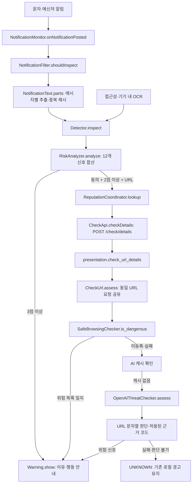

# GWUK COOKIE PATROL 심사 의견 반영 보고서

이번 작업은 기존 Kotlin/Compose 앱과 FastAPI 레이어 구조를 유지하며 실제 수신·실패 처리의 빈틈과 평가 근거 부족을 보완했다. 자동 시험과 합성 데이터 평가를 수행했으며, **실기기 검증은 미완료, 실제 Google·OpenAI 탐지 성능은 미측정, 키가 필요한 비교는 미실행**이다. 결과를 실제 사용자 피해 감소 효과로 해석하지 않는다.

추가 재점검은 [재점검 결과](재점검_결과.md)에 기록했다. 개발·평가 문구 사이에 의미가 유사한 사례가 있어 **독립적인 탐지 성능 검증도 미완료**다.

## 작업 기준과 지침

- 로컬 브랜치: `feature/backend-check-api`
- 기준 커밋: `70923b46037a166bf3cc6c6fa248d4f764f60f8c` (2026-10-29)
- 작업일: 2026-11-16. 아래 실행 기록은 커밋 전 작업 트리를 검증한 시점의 스냅샷이다. 이후 커밋·push 여부는 Git 기록으로 확인한다. 원격 main을 병합한 검증은 아니다.
- 프로젝트와 상위 경로에서 적용할 `AGENTS.md`는 발견하지 못했다. `PLAN.md`, 기존 README·개발 요약·데모 절차를 확인했다. 코드 탐색·Python 환경·OpenAI 공식 문서 스킬을 적용했다.
- 원본은 `.verification/baseline`의 별도 사본으로 복원해 시험했다. 작업 중 코드를 원본으로 덮어쓰지 않았다. 기준 기록은 [baseline.txt](verification/baseline.txt)와 `baseline-*` 로그다.
- 원격 PR #13(11-02 병합)의 URL 재경고 수정은 로컬 기준 커밋보다 이후다. 원격 기록을 읽어 확인했으나 이 작업에 원격 main을 병합하지 않았다. 이번 coordinator가 같은 문제의 동작을 별도로 검증한다.

## 발견한 문제와 반영

| 심사 의견 / 문제 | 반영 내용 | 주요 파일 |
|---|---|---|
| 실제 알림 형식·묶음 알림 검증 부족 | MessagingStyle→InboxStyle 줄→확장 본문→본문→제목 fallback. 메시지 간 위험 문맥 합산 방지, 빈 요약 제외, 처리량 제한 | `monitor/NotificationMonitor.kt`, `NotificationText.kt`, `NotificationTextTest.kt` |
| 반복 때문에 새 위험이 누락 | 이유 하나로 30초간 전체 경고를 막던 구조를 사건별 해시로 변경. 새 사건의 알림·화면 PendingIntent도 분리 | `detect/Detector.kt`, `warn/Warning.kt` |
| URL 쿨다운으로 재방문 경고 누락 | URL별 진행 중 요청 공유, 새 사건마다 결과 전달. AI 최대 5분, Google은 남은 유효시간 이내로 재사용. 실패는 캐시하지 않음 | `ReputationCoordinator.kt`, `ReputationCoordinatorTest.kt` |
| 비동기 응답이 강한 경고를 덮음 | 같은 사건에서 Google→AI→로컬→검사 불가 순서로 근거를 보호. 새 사건은 별도 경고 | `warn/WarningHistory.kt`, `WarningHistoryTest.kt` |
| 권한의 목적·전송·철회 설명 부족 | 기능별 설명 대화상자, 켜기/끄기, 다운로드 의존성, 서비스 연결 표시, 경고 채널 확인, 설정 복귀 시 재조회 | `MainActivity.kt`, `ui/PermissionGuide.kt`, `HomeScreen.kt` |
| 외부 전송 동의 불명확 | 자동 URL 검사는 기본 꺼짐. 별도 설명·동의·철회. 로컬 경고와 독립. 직접 검사는 버튼별 전송 안내 | `PrivacySettings.kt`, `ManualCheckActivity.kt` |
| 실제 기기 오류·과부하 | 서비스 재연결 요청, 파일 조회를 제한된 백그라운드 큐로 이동, 권한 해제/오류 방어, 설정 Intent 실패 안내 | `NotificationMonitor.kt`, `MainActivity.kt` |
| OCR 반복·개인정보 | 연속 이벤트로 검사가 영구 지연되지 않도록 수집. OCR 최소 2초 간격. 동일 텍스트 재검사 억제, 비밀번호 노드 건너뛰기, 기존 버퍼 해제 유지 | `ScreenMonitor.kt` |
| 오탐·미탐 수치 없음 | 개발용 60+평가용 60, 원본/수정 Kotlin 로직 실행, 지표·분모·오류 ID·시간·호출 수·실패를 출력 | `evaluation/Evaluation.kt`, `EvaluationTest.kt`, `backend/evaluation.py` |
| AI 역할·설명 부족 | URL 분석 범위를 프롬프트에 명시, 판단 유형을 제한된 코드로 반환. Google/AI/cache 출처 구분, AI를 확정 DB 판정처럼 설명하지 않음 | `openai_checker.py`, `domain/url_check.py`, `CheckApi.kt` |
| 서버 실패·중복 요청 | 동시 동일 URL 검사 공유(서버도 64건 한도), 503·429를 판단 불가로 처리, 로컬 경고 유지 | `application/check_url.py`, `presentation/__init__.py` |
| 개인정보가 오류에 반사됨 | 422 기본 검증 오류에 입력 URL·토큰이 포함되지 않도록 일반 메시지 반환. 자유 서술 AI 출력·외부 이유를 알림에 그대로 표시하지 않음 | `backend/app/main.py`, `test_privacy.py`, `CheckApi.kt` |
| 실기기 성능 증빙·협업 일정 | 수동 실험 JSON, 3대 기록표, 촬영안, Git 근거와 팀원 제공 경험/확인 필요 칸 | `FieldTrialActivity.kt`, [실기기 검증표](실기기_검증표.md), [협업 기록](협업_기록.md) |

Android 경로의 접두사는 `frontend/app/src/main/java/com/cookiepatrol/`이며, 디버그 실험 화면은 `src/debug/java/...`에만 포함된다. 앱 버전은 `0.2.1(3)`다.

## 실제 호출 흐름



| 단계 | 실제 파일·함수 | 처리 |
|---|---|---|
| 지원 알림 | `NotificationFilter.shouldInspect` | Google 메시지·삼성 메시지·Android mms·카카오톡 패키지 또는 `CATEGORY_MESSAGE`. 모든 앱의 내용을 무조건 읽어 점수화하지 않음 |
| 알림 추출 | `NotificationMonitor.onNotificationPosted`, `NotificationText.parts` | `NotificationCompat.MessagingStyle`의 최근 메시지, `EXTRA_TEXT_LINES`, `EXTRA_BIG_TEXT`, `EXTRA_TEXT`, 제목 순. 과거 메시지 배열은 별도 스캔하지 않음. 한 번에 최대 10개×12,000자 |
| 기기 내 검사 | `Detector.inspect` → `RiskAnalyzer.analyze` | URL 정규화 결과도 신호 검사에 포함. 원문 최대 12,000자. 3점 로컬 경고를 외부 요청보다 먼저 실행 |
| 자동 외부 검사 | `PrivacySettings.remoteEnabled`, `ReputationCoordinator.lookup` | 동의+2점+URL 조건, 2 workers·대기 64개. 같은 URL 진행 작업 공유, 완료 결과 최대 500개. AI 최대 5분, Google은 남은 유효시간 이내 |
| HTTP | `CheckApi.checkDetails` / `checkAt` | URL JSON만 전송. 연결 3초·읽기 25초, 리다이렉트 금지, 응답 최대 16,384문자, 실패·불일치→UNKNOWN |
| 서버 | `check_url_details` → `CheckUrl.assess` | 두 API가 IP별 분당 60회 제한 공유. 동일 URL 검사 최대 64건, 대기자는 22초 한도 |
| 제공자 | `SafeBrowsingChecker.is_dangerous` → 필요 시 `OpenAIThreatChecker.assess` | Google 5초, AI 15초. Google 위험 결과가 AI 캐시보다 우선 |
| 경고 | `Warning.show` → `WarningActivity` → `WarningScreen` | 알림·채널 차단 시 예외 없이 실패 처리, 알림 클릭 때만 화면 열림. 사건별 알림 최대 10개, 오래된 알림 정리. 사용자 진행을 강제 차단하지 않음 |

설치·다운로드 감시는 `NotificationMonitor.onListenerConnected`가 리시버·MediaStore 관찰자를 등록하고, 연결 종료 시 해제한다. 원격제어 패키지·APK는 텍스트 점수와 별도로 경고한다. 화면 감시는 `ScreenMonitor.onAccessibilityEvent` → `scanActiveWindow` → `recognizeScreenshot`/접근성 fallback → `inspectText` → `Detector.inspect`다.

## 기존 설명과 코드의 차이

12개 신호, 경고 3점, URL 포함 2점 후보, Google 우선+AI URL 문자열 분석은 기준 코드에도 존재했다. ‘AI가 페이지를 방문해 진위를 확인’하는 기능은 없고 지금도 없다. 점수 근거 실험·실기기 정확도는 기존 문서에 없었다.

이번에는 자동 외부 검사에 **별도 전송 동의**를 추가했다. 기존 설명의 자동 조회 흐름 앞에 이 조건이 붙는다. 2점 미만 주소는 자동 외부 검사를 통과하지 못하며, 새 직접 검사 화면에서만 사용자 선택으로 검사할 수 있다. 금지 안내를 요구 문장으로 잘못 읽는 두 규칙을 보완했지만 12개 신호와 가중치·2/3점 기준은 유지했다.

기존 자료의 ‘24시간 저장’은 판정 유효기간과 실제 파일 정리 시점을 혼동할 수 있었다. 현재 안내는 AI 판정을 24시간 사용하고 만료 항목은 조회/저장 시 삭제한다고 설명한다. Google 긍정 캐시는 제공자 `cacheDuration`을 따른다.

## AI 입력·출력과 호환성

모델은 `OPENAI_MODEL`, 기본 `gpt-4.1-mini`다. 프롬프트 전체는 `openai_checker.py`의 `INSTRUCTIONS`에 공개돼 있다. 입력은 `{"url":"..."}` 하나이며 문자·알림 제목·화면 이미지 전체를 보내지 않는다. URL의 호스트·하위 도메인·경로·쿼리 사이 위장 관계를 보완 분석한다. 페이지 내용·최종 이동 주소·등록일·실시간 사이트 신원을 확인할 수 없다.

모델 응답은 `verdict`(`dangerous/not_detected/unknown`)와 `indicators`다. 코드는 브랜드 위장·인증 유도·호스트 혼동·인코딩된 목적지·설치 유도의 다섯 가지로 제한한다. 위험이면 최소 한 코드, 위험 미감지이면 빈 코드만 허용한다. 모순·중복·허용 밖 코드·거절·잘린 응답·잘못된 JSON은 실패 처리한다. URL 내부의 지시문은 신뢰하지 않는 JSON 데이터라고 명시한다. 관련 테스트는 요청 데이터와 프롬프트 분리·잘못된 형식 처리를 검증하며, 실제 모델의 프롬프트 공격 방어율을 입증하지 않는다.

[OpenAI 공식 문서](https://developers.openai.com/api/docs/guides/structured-outputs?api-mode=responses)의 `text.format` JSON Schema 방식을 사용한다. 응답 형식 보장은 판단 정확도 보장이 아니다. `store:false`, 출력 한도 200토큰, 브라우징 도구 없음은 유지했다.

기존 `POST /check`의 `{"dangerous":true/false}` 응답은 그대로다. 새 Android는 `POST /check/details`를 사용한다.

```json
{
  "dangerous": true,
  "source": "ai",
  "indicators": ["deceptive_host"],
  "reason": "AI가 주소에서 위험 신호를 찾았어요. 주소의 실제 연결 대상을 혼동하게 하는 구조가 보여요.",
  "prompt_version": "url-structure-v2",
  "google_cache_ttl_seconds": 0.0,
  "limitation": "AI는 주소 문자열만 분석해요. 웹페이지·이동 경로를 확인하지 않으며 안전을 보증하지 않아요."
}
```

출처는 `safe_browsing`, `ai`, `ai_cache`다. 캐시에 근거 문구를 저장하지 않아 `ai_cache`는 과거 코드가 현재 확인된 근거인 것처럼 복원하지 않는다. 앱은 허용된 코드로 한국어 이유를 만들고 서버 자유 서술을 그대로 띄우지 않는다. 실패는 HTTP 503, 요청 제한은 429, 잘못된 요청은 422다. Android는 이를 UNKNOWN으로 처리한다. 백엔드를 먼저 갱신한 뒤 앱을 갱신한다. 옛 서버에서 새 경로가 404이면 새 앱은 추가 검사 불가로 처리하고 로컬 경고를 유지한다.

`google_cache_ttl_seconds`는 Google 위험 결과의 남은 유효시간이며 앱은 통신 시간도 차감한다. 필드가 없는 이전 상세 응답은 경고를 표시하되 Google 판정을 기기에 재사용하지 않는다. Google 조회가 실패해도 AI가 유효한 응답을 주면 그 응답을 사용하며, 로컬 경고는 유지한다.

## 실행한 검증

최종 수치는 [summary.json](verification/summary.json), [Android 로그](verification/android-current.log), [백엔드 로그](verification/backend.log), JUnit XML에 연결된다. 과거 문서의 숫자를 그대로 복사한 결과가 아니다.

| 항목 | 기준 커밋 재실행 | 변경 후 |
|---|---|---|
| 백엔드 pytest | 103개 통과 | 132개 통과 |
| Android JVM | 23개 통과 | 44개 통과 |
| 디버그·릴리스 빌드 | 통과 | 통과(릴리스 APK 미서명) |
| lintDebug | 통과 | 오류 0, 경고는 최종 summary 참조 |
| 실제 Google·AI 탐지 | 미실행 | 미실행·미측정, 실제 외부 호출 0회 |
| 연결된 Android 기기 | 없음 | 실기기·에뮬레이터 미검증 |

원본 Android 빌드 첫 시도는 D8 Java heap 부족으로 실패했다. `-Xmx2048m`, workers 2로 재실행해 통과했고 이 설정을 현재 `gradle.properties`에도 반영했다. 구현 중 MessagingStyle 어댑터·JVM HTTP 시험 서버 컴파일 오류도 수정 후 재실행했다. 중간 실패 로그는 `verification`에 보존했으며 최종 성공 로그와 구분한다. SDK XML 도구 버전·Gradle deprecation·SDK/의존성 갱신 권고는 남아 있다. 최신 SDK로 올린 뒤 제조사별 동작을 검증한 결과는 아니다.

서버 테스트는 외부 HTTP 응답을 모의 처리한다. Android transport 시험은 로컬 loopback 서버와 실제 `HttpURLConnection`으로 POST JSON·상세 응답·429·503·잘못된 JSON·과대 응답을 검사한다. Android OS의 알림 전달이나 OCR 캡처 성공까지 시험한 것은 아니다.

## 오탐·미탐 결과

개발용 60개와 별도 평가용 60개, 각 정상 30·피싱 의심 30이다. 전부 합성 문장이다. 원본/수정 규칙은 같은 데이터에서 실제 Kotlin을 실행했다. [전체 결과](evaluation/mock-results.md)와 [지표 JSON](evaluation/mock-results.json)에 사례별 예측·점수·이유 코드·오류 목록·비율의 분자/분모가 있다.

평가용 60개에서 로컬 규칙 결과:

| 구성 | TP | FP | TN | FN | 정밀도 | 재현율 | F1 | 오탐률 |
|---|---:|---:|---:|---:|---:|---:|---:|---:|
| 원본 규칙 | 20 | 4 | 26 | 10 | 83.33% | 66.67% | 74.07% | 13.33% |
| 수정 규칙 | 20 | 1 | 29 | 10 | 95.24% | 66.67% | 78.43% | 3.33% |

남는 로컬 오탐은 정상 개발용 IP 서버 안내 EN06이다. 미탐은 EP17·18·19·20·21·22·23·24·25·28이며, 평범한 HTTPS 문구·단독 2점·URL 없는 요구가 중심이다. 줄어든 오탐은 보안 교육·금지 안내 문장에 대한 것이고, 미탐 개선 효과는 확인하지 못했다. 이 60개에서 오탐률이 낮아졌다고 모든 실제 폰과 문자에서도 같다고 말할 수 없다.

재점검에서 N14↔EN11·EN24, N15↔EN12, N26↔EN06의 의미 유사성을 발견했다. 위 60개 수치는 **합성 회귀 시험**이며 독립 평가의 개선 효과로 발표할 수 없다. 해당 평가 ID 4개를 사후 제외한 56개에서는 원본/수정 모두 TP20·FP0·TN26·FN10이었다. 어려운 정상 사례를 제외한 민감도 확인이므로 이 수치도 새 정확도의 근거가 아니다. 원본 60개 결과를 보존하고 새 독립 자료 확보를 남은 작업으로 기록했다.

평가용 **모의 시험** 비교:

| 구성 | TP / FP / TN / FN | 판단 불가 | 전체 위험 30건 대비 탐지 | Google / AI 논리 조회 |
|---|---|---:|---:|---:|
| 규칙 | 20 / 1 / 29 / 10 | 0 | 20/30 | 0 / 0 |
| 규칙+Google 모의 | 21 / 1 / 29 / 8 | 1 | 21/30 | 17 / 0 |
| 규칙+Google+AI 모의 | 23 / 2 / 28 / 5 | 2 | 23/30 | 17 / 16 |

모의 AI는 EP20·21을 보완하고 EN21을 오탐하도록 **지정**했다. 실제 모델의 개선/악화 관측이 아니다. 마지막 구성의 주 재현율은 판단 불가 2개를 제외한 23/28이며, 전체 위험 대비 23/30도 같이 제시한다. 모의 외부 지연은 0, 실제 요청은 0회다. 로컬 시간은 Windows JVM 측정이며 실제 휴대폰 지연·배터리 부담은 미측정이다.

가중치 근거·정성 근거·공식 통계는 [규칙과 점수의 근거](규칙_점수_근거.md), 재실행 명령과 실제 비교 준비는 [평가 실행 방법](평가_실행_방법.md)에 있다.

## 권한·개인정보와 남은 한계

| 기능 | 필요한 설정·권한 | 읽거나 전송하는 정보 / 끄면 |
|---|---|---|
| 경고 표시 | POST_NOTIFICATIONS/앱 알림·위험 경고 채널 | 이유·행동 안내만 알림. 끄면 전달 불가, 앱에 상태 표시 |
| 문자·카톡 | 사용자가 켜는 알림 접근 | 지원 알림의 본문. OS는 더 넓은 접근 권한을 주지만 앱에서 필터. 끄면 알림·설치·다운로드 감시 중지 |
| 화면 읽기·OCR | 선택적 접근성 서비스, XML의 화면 내용/스크린샷 capability | 화면 글자·일시 캡처. MediaProjection 별도 권한을 쓰는 구현이 아님. 캡처를 파일·서버에 저장하지 않음. 끄면 화면 감시 중지 |
| 다운로드 | 데모의 모든 파일 접근+알림 서비스 연결 | MediaStore 파일명·변경 URI. 파일 내용을 서버에 보내지 않음 |
| 앱 설치 | 알림 서비스의 패키지 리시버·QUERY_ALL_PACKAGES(데모) | 패키지와 설치 출처. 공개 스토어 설치·원격제어 앱 자체가 사기 확정이라는 뜻은 아님 |
| 외부 URL 검사 | INTERNET+별도 앱 내 전송 동의, 직접 검사는 명시 버튼 | 전체 후보 URL을 서버·Google·필요 시 OpenAI로 전송. 경로/쿼리에 민감값이 있을 수 있음 |

권한은 홈 설명에서 시스템 설정으로 이동하고 같은 설정에서 해제한다. 설정 복귀 시 실제 권한을 다시 읽는다. 알림 권한과 서비스 연결 상태를 구분한다. 설정 화면을 열 수 없는 제조사 환경은 안내 메시지로 처리한다. 전체 화면 강제 차단·알 수 없는 APK 자동 실행은 하지 않는다.

알림 본문·OTP·URL 원문을 로그에 쓰는 코드나 분석/크래시 수집 SDK는 추가하지 않았다. 서버 입력 검증 오류도 원문을 반사하지 않는다. URL 캐시·중복 키는 SHA-256이지만 익명화가 아니며 접근 제한이 필요하다. 모델 설명 코드만 보존하고 자유 서술·URL 근거 원문을 캐시에 추가하지 않았다. 앱 백업·기기 간 자동 전송에서 동의/실험 기록을 제외한다. 수동 내보내기 JSON은 담당자가 직접 관리한다. 기본 서버 접속 로그에는 접속 IP와 API 경로가 남을 수 있어 팀의 보관 정책이 필요하다. 프록시·배포 서비스의 요청 본문/인증 헤더 기록도 별도로 확인해야 한다.

공식 [Android 15 동작 변경](https://developer.android.com/about/versions/15/behavior-changes-all#otp-notifications)은 OTP가 포함된 알림을 신뢰되지 않은 리스너에서 가릴 수 있다고 설명한다. 카카오톡·문자 앱의 모든 버전에 동일한 extras가 온다고 보장하는 공개 계약은 확인하지 못했다. 실제 형식 수집·숨김 알림·묶음 재전송·절전·파일 공개 범위는 기기별 시험이 필요하다. 본문이 같은 새 메시지와 반복 업데이트의 시각까지 같은 경우 완전한 구분은 어렵고, 그룹 summary/child의 중복이 남을 수 있다.

본문 22sp·경고 26sp 중심, 최소 버튼 높이 72dp, 스크롤·줄바꿈을 유지했다. 200% 글자 확대·TalkBack·실제 캡처 화면의 잘림은 연결 기기가 없어 확인하지 못했다. 접근성·모든 파일·전체 패키지 조회는 데모 범위이며 이 APK의 빌드 성공이 Play Store 승인이나 배포 준비 완료를 뜻하지 않는다. 약관·저작권·운영 데이터 처리 조건은 팀이 확정해야 한다.

## 팀원의 남은 확인

1. [실기기 표](실기기_검증표.md)에 2~3대의 기종·OS·문자 앱·권한·실제 결과를 채우고 영상 촬영.
2. 합성 라벨을 독립 검토하고, 실제 사용 동의를 받은 비식별 자료를 별도 평가. 개발용/평가용 혼합 방지.
3. 팀이 키를 직접 설정한 후 [실제 비교 절차](평가_실행_방법.md)로 재실행. 현재 실제 제공자 성능은 미측정으로 유지.
4. [협업 기록](협업_기록.md)의 실제 담당자·모임 날짜·당시 오류·논의·해결 근거를 확인. 전달받은 멘토링 외 미팅 경험은 팀원 제공 사실로 구분해 반영함.
5. 변경 코드 리뷰 후 최신 main의 관련 PR과 통합, 실제 HTTPS 서버로 빌드·시연. 이용약관·배포 권한 범위 확정.
